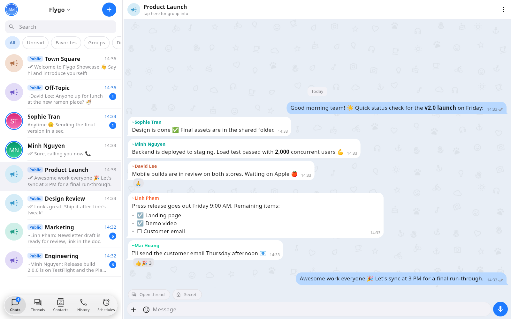
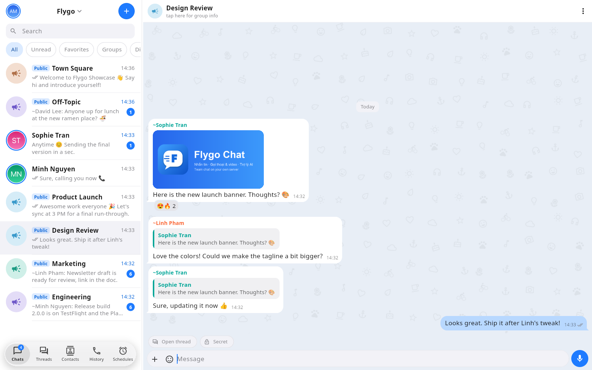
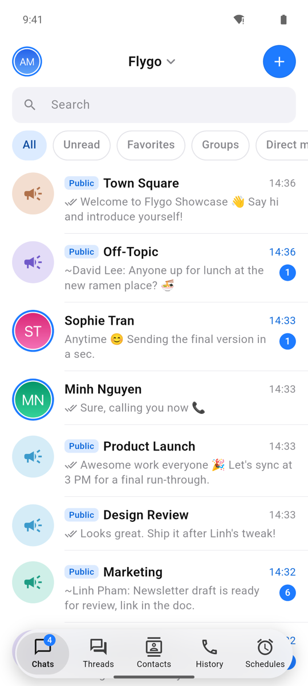
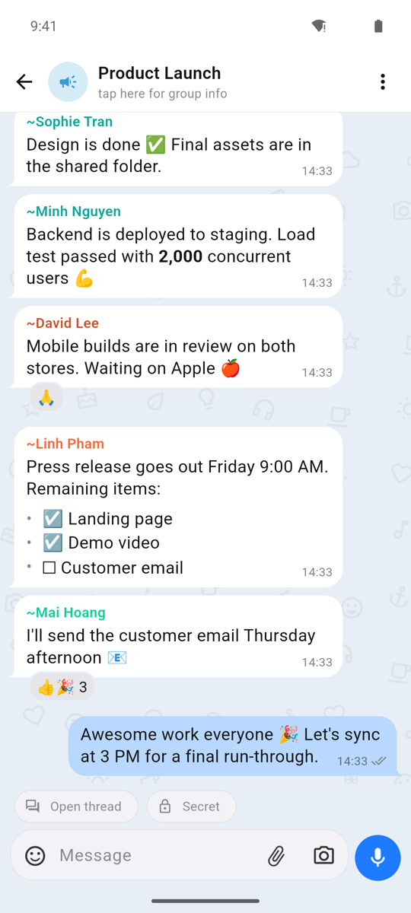
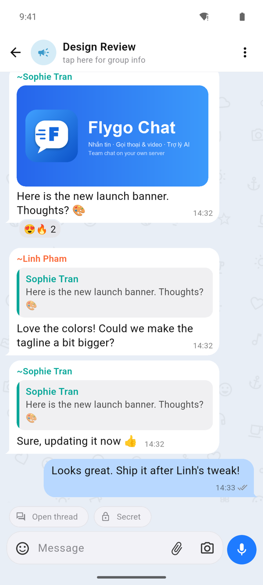
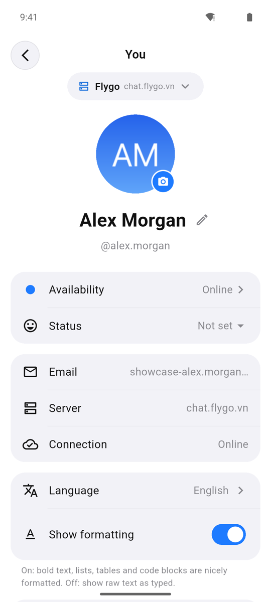

# Flygo Chat

Flygo Chat is a team messenger for messaging plus voice and video calls. It is built with Flutter and runs on **Windows, macOS, Linux, Android and iOS** from a single codebase.

The app works with Mattermost-compatible servers. It has no built-in server: on the sign-in screen users enter their work email, and the app finds the company chat server from the email domain (for example `name@example.com` → `chat.example.com`). Users can add more servers later. Everything else (push station, update channel, static files) comes from the server the user is signed in to.

## Screenshots

**Desktop** (Windows, macOS, Linux)





**Mobile** (Android, iOS)

<p>
  
  
  
  
</p>

## Features

- Group and direct messages, threaded replies, reactions, pinned messages and search
- Voice and video calls, including group calls; on phones, incoming calls show full screen even when the device is locked
- Notifications for messages and calls: push notifications on mobile, native notifications on desktop
- Windows: keeps running in the system tray after the window is closed, and can start with Windows
- AI assistant bots in chat for Q&A, summaries and drafting
- Voice messages with speech-to-text
- Photos, videos, stickers, GIFs and file sharing, plus a built-in image editor
- Several servers and accounts in one app; on desktop, separate windows per chat or per server
- Report messages, block users and request account deletion in the app
- UI in Vietnamese, English, Korean, Japanese, Thai and Chinese

## Quick start

```sh
git clone https://github.com/flygo-technology/flygo-chat.git
cd flygo-chat
flutter pub get
flutter build windows --release   # or: macos, linux, apk --flavor sideload
```

No configuration is needed: the build connects to the Flygo server out of the box. For requirements, per-platform steps, signing in, notifications and customization, see the **[build guide](docs/BUILD.md)**.

## Project layout

| Path | Contents |
|---|---|
| `lib/` | Dart source: `api/` (Mattermost REST + WebSocket), `state/`, `ui/`, `calls/` (WebRTC calls), `push/`, `agent/` (AI assistants), `update/` (self-update), `i18n/` |
| `android/`, `ios/`, `macos/`, `windows/`, `linux/` | Platform runners. `windows/runner/` also holds the system tray and the taskbar badge. |
| `assets/` | Ringtones, icons, engine logos |
| `agent/` | AI assistant runner (flygo-agent, TypeScript/Bun) and the A2A relay. See [Part D of the build guide](docs/BUILD.md#part-d-ai-assistant-runner) |
| `tool/` | Maintainer scripts: publish self-updates, bundle the AI runner, i18n helpers |
| `test/` | Unit and widget tests (`flutter test`) |
| `docs/BUILD.md` | Build guide |

## License

The source code is public so that you can review it and build the app for use with Flygo servers. It is **not** open source. Redistribution, publishing to app stores, rebranding, or using your own servers requires a written agreement with Flygo Technology. See [LICENSE](LICENSE).
